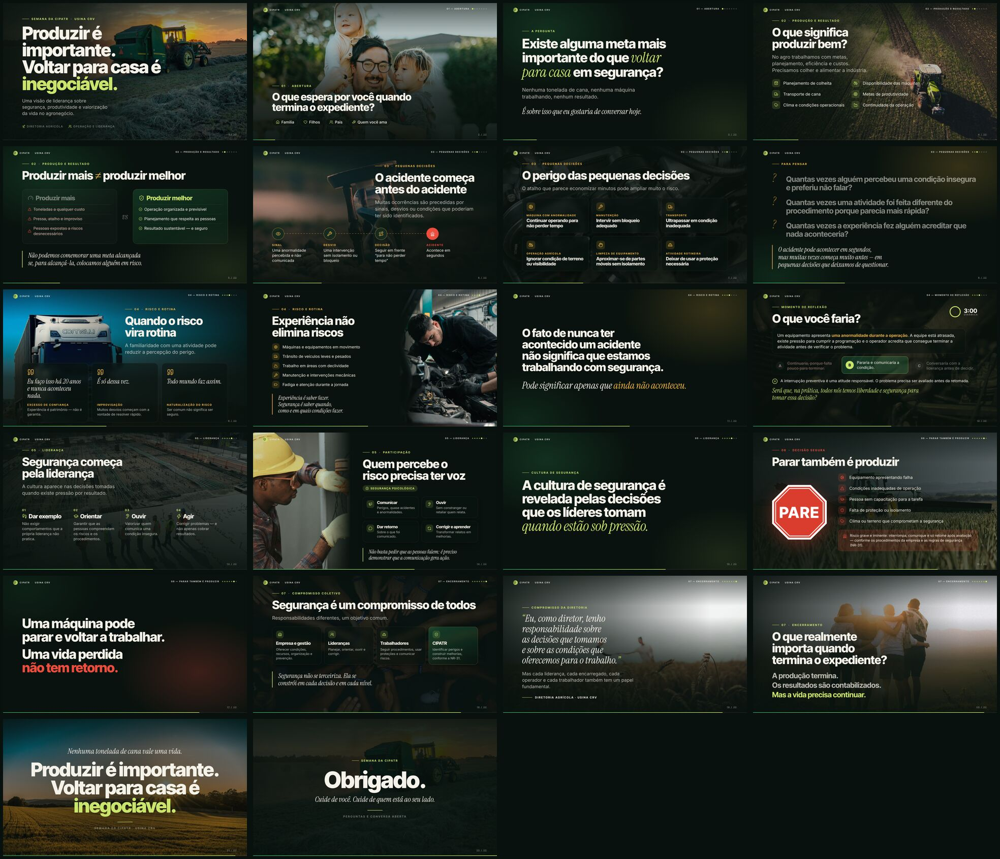

# Produzir é importante. Voltar para casa é inegociável.

**Palestra da Semana da CIPATR — Usina CRV**
*Uma visão de liderança sobre segurança, produtividade e valorização da vida no agronegócio.*

Apresentação web cinematográfica (22 slides, ~40 min) feita com **reveal.js 6**: fotos em tela cheia com movimento suave (efeito Ken Burns), tipografia editorial, animações de entrada palavra por palavra, dinâmica interativa com cronômetro e **modo apresentador** com o roteiro completo e controle de tempo por slide.



> **Nova versão — VIII SIPAT/SIPATR 2026:** a pasta [`sipat-2026/`](sipat-2026/) traz a palestra mesclada no formato do artefato da SIPAT (palco 16:9 com hachura e partículas, boot, votações A/B, contador ao vivo, pessoas que acendem), com o conteúdo e as fotos desta apresentação e a identificação *Cloves Oliveira · Superintendente Agrícola CRV-MG · 23 de novembro*. Versão online (privada, compartilhe pelo menu Share): https://claude.ai/artifact/FmTVHADHCfhMe3kecrFYyz
>
> Para apresentar localmente, abra `sipat-2026/index.html` no Chrome ou Edge. Atalhos: → avança · ← volta · **F** tela cheia · **N** notas. As fontes vêm do Google Fonts; sem internet, a página usa Arial.

---

## Como apresentar

**Não precisa de internet nem de instalação.** Tudo (fontes, ícones, fotos e reveal.js) está dentro do repositório.

1. Baixe o repositório (botão **Code → Download ZIP**) e descompacte.
2. Abra o arquivo **`index.html`** no Google Chrome ou Microsoft Edge (duplo clique).
3. Pressione **F** para tela cheia e **S** para abrir o modo apresentador.

> No modo apresentador (janela separada, para o notebook) aparecem: o roteiro de fala de cada slide, o próximo slide, o relógio e o **ritmo** — quanto tempo resta para o slide atual, com base na meta de 40 minutos. Projete a janela principal e mantenha a janela de notas na sua tela.

### Atalhos

| Tecla | Ação |
|---|---|
| `→` / `Espaço` / `Page Down` | Avançar (passador de slides funciona) |
| `←` / `Page Up` | Voltar |
| `F` | Tela cheia |
| `S` | Modo apresentador (notas + cronômetro) |
| `B` ou `.` | Tela preta (pausa para conversa) |
| `O` ou `Esc` | Visão geral de todos os slides |
| `Home` / `End` | Primeiro / último slide |
| `?` | Lista completa de atalhos |

### Dinâmica (slide 12 — "O que você faria?")
- **Clique no cronômetro** (canto superior direito) para iniciar/pausar os 3 minutos. Duplo clique zera.
- **Clique nas opções A, B e C** para marcá-las enquanto o público levanta a mão.
- **Avance** para destacar a resposta (parar e comunicar) e, em seguida, a pergunta aberta para discussão.

### Plano B — PDF
Se não houver navegador disponível, use **[`export/Palestra_CIPATR_Produzir_e_Voltar_para_Casa.pdf`](export/Palestra_CIPATR_Produzir_e_Voltar_para_Casa.pdf)** (uma página por slide, 16:9). O roteiro também pode ser impresso: **[`docs/roteiro-do-apresentador.md`](docs/roteiro-do-apresentador.md)**.

---

## Estrutura da palestra

| # | Slide | Bloco | Tempo |
|---|---|---|---|
| 1 | Produzir é importante. Voltar para casa é inegociável. | Capa | 0:30 |
| 2 | O que espera por você quando termina o expediente? | 01 · Abertura | 2:30 |
| 3 | Existe alguma meta mais importante do que voltar para casa? | 01 · Abertura | 1:30 |
| 4 | O que significa produzir bem? | 02 · Produção e resultado | 2:00 |
| 5 | Produzir mais ≠ produzir melhor | 02 · Produção e resultado | 2:00 |
| 6 | O acidente começa antes do acidente | 03 · Pequenas decisões | 2:00 |
| 7 | O perigo das pequenas decisões | 03 · Pequenas decisões | 2:30 |
| 8 | Para pensar: "Quantas vezes…?" | 03 · Pequenas decisões | 2:00 |
| 9 | Quando o risco vira rotina | 04 · Risco e rotina | 2:30 |
| 10 | Experiência não elimina riscos | 04 · Risco e rotina | 2:30 |
| 11 | "Pode significar apenas que ainda não aconteceu." | 04 · Risco e rotina | 1:00 |
| 12 | **Dinâmica:** O que você faria? | Momento de reflexão | 3:00 |
| 13 | Segurança começa pela liderança | 05 · Liderança | 2:30 |
| 14 | Quem percebe o risco precisa ter voz | 05 · Liderança | 2:30 |
| 15 | A cultura se revela sob pressão | 05 · Liderança | 1:00 |
| 16 | Parar também é produzir | 06 · Decisão segura | 2:30 |
| 17 | "Uma vida perdida não tem retorno." | 06 · Decisão segura | 1:00 |
| 18 | Segurança é um compromisso de todos | 07 · Encerramento | 2:00 |
| 19 | Compromisso da diretoria | 07 · Encerramento | 1:30 |
| 20 | O que realmente importa quando termina o expediente? | 07 · Encerramento | 1:30 |
| 21 | Nenhuma tonelada de cana vale uma vida. | Mensagem final | 1:00 |
| 22 | Obrigado | — | 0:30 |
| | | **Total** | **40:00** |

Os 12 slides recomendados no roteiro original estão todos presentes; foram acrescentados a dinâmica, os slides de "frase de impacto" (para as pausas) e o compromisso público da diretoria.

---

## Personalizar

- **Textos:** edite `index.html`. Cada slide é um bloco `<section>`; as falas ficam em `<aside class="notes">`.
- **Fotos próprias da usina:** substitua os arquivos em `img/` mantendo o mesmo nome (ideal: horizontal, 1920 px de largura, JPG). Fotos reais da operação deixam a palestra ainda mais próxima do público. Evite expor pessoas identificáveis sem autorização.
- **Tempo por slide:** atributo `data-timing` (em segundos) de cada `<section>`.
- **Cores e fontes:** variáveis no topo de `css/theme.css`.

### Para desenvolvedores

```bash
npm install        # baixa reveal.js, fontes e ícones
npm run vendor     # copia as dependências para vendor/
npm start          # servidor local em http://localhost:8080
npm run pdf        # regenera o PDF (requer Playwright)
```

Publicação online (opcional): em **Settings → Pages**, escolha *GitHub Actions* e rode o workflow **"Publicar apresentação (GitHub Pages)"** em **Actions**.

```
index.html            slides + roteiro do apresentador
css/theme.css         identidade visual
js/app.js             ícones, animações, véus das fotos, dinâmica e cronômetro
img/                  fotografias (ver CREDITOS.md)
vendor/               reveal.js, fontes e ícones (offline)
export/               PDF de reserva
docs/                 roteiro impresso e prévia
scripts/              vendor, servidor local e exportação PDF
```

Créditos de fotos, fontes e bibliotecas: [CREDITOS.md](CREDITOS.md).
